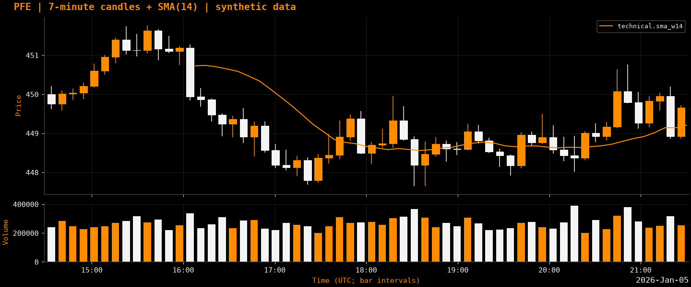
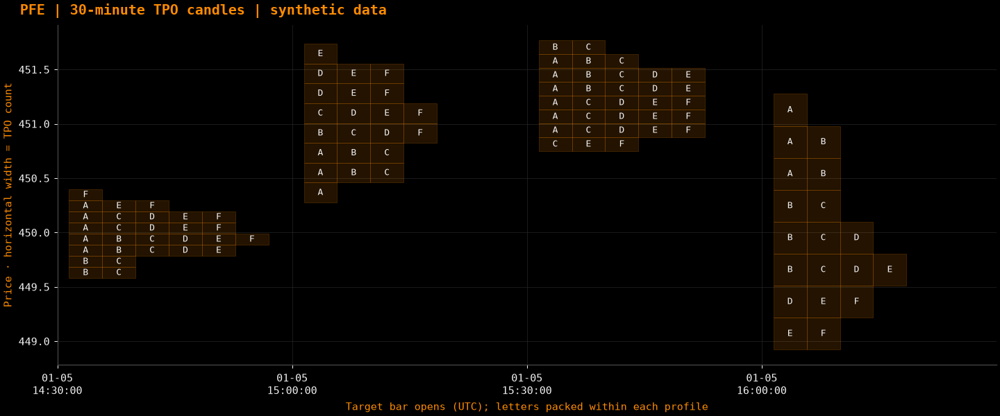
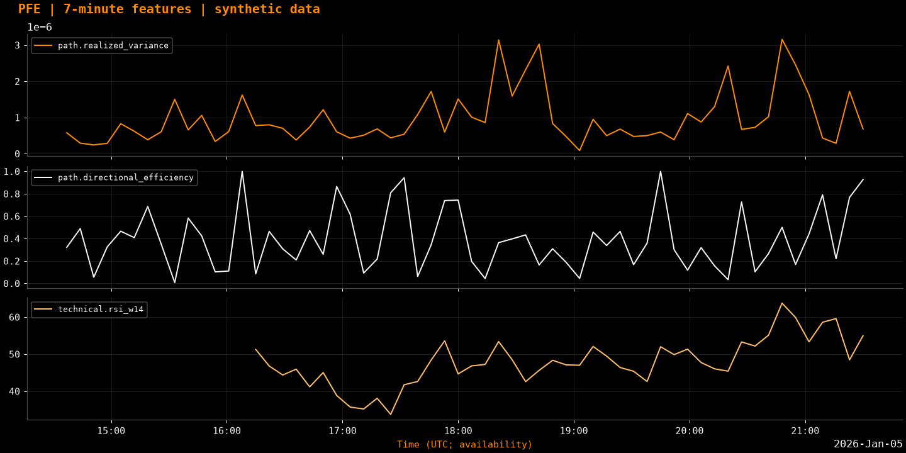

# PFE · Price Feature Engineering

Python library for market-price features: standard OHLCV indicators and richer
candles built from finer data. The initial data source is **QQQ, 1-minute OHLCV**
from [London Strategic Edge](https://londonstrategicedge.com/), using its
[official SDK](https://github.com/londonstrategicedge/lse-data).

## Setup

Requires Python 3.12+, [uv](https://docs.astral.sh/uv/) and a C++17 compiler
(Xcode command-line tools on macOS, GCC/Clang on Linux, MSVC on Windows).

```bash
make setup                              # Library, LSE SDK, plotting, dev tools
uv run python examples/quickstart.py     # Synthetic example; no API key needed
```

C++ kernels compile automatically. `uv sync` installs the core library without
the optional LSE/plotting extras. On macOS, `.venv` points to `venv/` to preserve
editable imports.

## Download data

Copy `.env.example` to `.env` and set `LSE_API_KEY`, then run:

```bash
uv run --extra lse --env-file .env python scripts/download_data.py \
  --ticker QQQ --start 2026-01-05 --end 2026-01-10
```

Use **`YYYY-MM-DD`**: start inclusive, end exclusive, UTC. ISO timestamps such as
`2026-01-05T14:30:00Z` also work; the script filters the requested times locally.
Raw exports go to `data/raw/`, normalized Parquet to `data/processed/`.
Downloaded data and `.env` are ignored by Git.
Choose any ticker supported by your LSE account, e.g. `--ticker SPY` or
`--ticker AAPL`. Symbols are uppercased; QQQ remains the default. Paths include
the ticker, so identical date ranges for different symbols stay separate.

## Compute features

```python
from pfe import (
    load_bars,
    compute_feature,
    compute_selected_features,
    compute_features,
    enrich_bars,
    build_features,
)

bars = load_bars("data/processed/QQQ_1m_20260105T000000Z_20260110T000000Z.parquet")

# Individual features: compute only the requested dependencies.
rsi = compute_feature(bars, "technical.rsi", window=14)
selected = compute_selected_features(bars, ("returns.log", "technical.rsi_w14"))
rv = compute_feature(bars, "path.realized_variance", frequency="7min")

# Groups remain available.
source = compute_features(bars, windows=(5, 20), groups=("returns", "volatility"))
enriched = enrich_bars(bars, frequency="7min", segments=5, bins=12)
combined = build_features(bars, "45min", windows=(5, 20), groups=("trend",))
```

Choose any fixed integer multiple of the source duration: `3min`, `7min`, `45min`,
`2h`, etc. `source_frequency` defaults to `1min`; `origin` and `offset` control
alignment. Windows in `build_features` count **target candles**.
Indexes label opens; features become usable at close (`available_at` on enriched
frames). Warm-up values stay NaN, and rolling state resets across gaps by default.

## OHLCV feature groups

Tables summarize families. Use `feature_catalog(result)` for exact output names
and [the feature reference](docs/features.md) for parameters and definitions.

### `price`

| Family | Features |
|---|---|
| Price transforms | Median, typical, OHLC mean, weighted close |
| Log transforms | Log prices, log1p volume |

### `returns`

| Family | Features |
|---|---|
| Moves | Simple/log returns, absolute changes, open-to-close returns, gaps (`open_gap` aliases `gap`) |
| Horizons | Multi-bar returns, acceleration, volatility-scaled returns |

### `candles`

| Family | Features |
|---|---|
| Geometry | Body, range, upper/lower wicks, ratios, direction |
| Relationships | Overlap, expansion, inside/outside bars |

### `statistics`

| Family | Features |
|---|---|
| Location and spread | Rolling mean, median, min/max, std, variance, quantiles, IQR, MAD |
| Distribution | Skewness, excess kurtosis, ranks, standard/robust z-scores |

### `volatility`

| Family | Features |
|---|---|
| Return and range measures | True range, ATR, close std, EWMA, realized variance/volatility, semivariances |
| OHLC estimators | Parkinson, Garman–Klass, Rogers–Satchell, Yang–Zhang |
| Volatility dynamics | Volatility of volatility, ranks, short/long ratios |

### `trend`

| Family | Features |
|---|---|
| Moving averages | SMA/EMA, distance, slope, curvature, crosses, age since cross |
| Fit and persistence | Regression slope/intercept/R²/residual, efficiency, VHF, choppiness |

### `volume`

| Family | Features |
|---|---|
| Activity | Changes, rolling sum/mean/EMA/std, relative volume, ranks, z-scores, zeros, concentration |
| Price relationships | Dollar volume, Amihud/signed-volume proxies, VWAP proxy, price–volume correlations |

### `levels`

| Family | Features |
|---|---|
| Extremes | Rolling highs/lows, position, distances, extreme ages, prior-window breakouts |
| Excursions | Drawdown/drawup, maximum drawdown, time below rolling high |

### `sequences`

| Family | Features |
|---|---|
| Direction | Positive-return fraction, direction changes, runs |
| Dependence | Return, absolute-return and squared-return autocorrelations |

### `technical`

| Family | Features |
|---|---|
| TA-Lib | All overlap, momentum, volume, volatility, price-transform, cycle and statistics functions |
| Adaptive averages | RMA, ALMA, HMA, ZLEMA, VIDYA, FRAMA |
| Oscillators and flow | TSI, Vortex, Fisher, SMI, KDJ, Schaff, Coppock, Connors RSI, KST, CMF, PVT, NVI/PVI and more |
| Channels and candles | Bollinger measures, Keltner, Donchian, envelopes, Supertrend, causal DPO, Heikin-Ashi, available Ichimoku spans |

### `patterns`

| Family | Features |
|---|---|
| Candlestick patterns | All 61 TA-Lib patterns, numeric scores/direction |
| History | Age since pattern, trailing pattern frequency |

### `complexity`

| Family | Features |
|---|---|
| Distribution and dependence | Tail statistics, historical expected shortfall, entropy, Hurst estimate, Petrosian dimension, AR(1), lag-2 PACF |
| Frequency and scale | FFT frequency/energy/entropy/coefficients, Haar wavelet detail energy/coefficients |

### `structure`

| Family | Features |
|---|---|
| Swings | Higher/lower highs/lows, confirmed pivots, levels, event ages/distances, threshold ZigZag |
| Shapes | Tolerance-based double tops/bottoms, slope convergence, consolidation width |

### `calendar` (includes `session.*`)

| Family | Features |
|---|---|
| Time | Local clock/cyclical encodings, session progress |
| Session context | Evolving levels/volume/VWAP, opening range, same-slot relative volume/movement, previous-session pivots |
| Opening gaps | `session.night_gap` (weekday closure), `session.weekend_gap` (closure crossing a weekend) |

Session defaults: New York weekdays, 09:30–16:00 by clock. No holiday or early-close
calendar is inferred; `1D` aggregation means 24 elapsed hours.
Session gaps equal regular-session open / previous observed regular-session close
− 1 and persist within that session. Missing exact endpoints yield NaN.
`returns.open_gap` compares adjacent bars and follows `gap_policy`.

## Intrabar feature groups

These retain information inside each target candle using finer source OHLCV.

### `path`

| Family | Features |
|---|---|
| Variability | Realized variance/volatility, absolute/quadratic variation, semivariances, fine ranges |
| Direction | Efficiency, up/down/flat fractions, imbalance, turns, run lengths |
| Timing and excursions | Extreme order/timing/retests, drawdown/drawup, recovery, underwater time, threshold episodes |
| Move concentration | Largest moves, top 1/3/5 energy shares, threshold counts, early/late variance shares |
| Shape | Regression, curvature, signed/absolute area, straight-path deviation, open crossings |
| Volume and coupling | Volume entropy/concentration/timing, price–volume correlations, weighted returns, delayed relationships |
| Segments and scales | Per-segment return/range/variance/volume/position, segment changes, coarser internal-scale comparisons |

### `profile`

| Family | Features |
|---|---|
| Close occupation | Price-zone shares, entropy, concentration, stays, transitions, crossings, revisits |
| TPO | Price–time presence matrix, point of control (POC), 70% value area, single-block rows |
| Evolution | Intersegment overlap, active zones, price-center migration |

### `quality`

| Family | Features |
|---|---|
| Coverage | Observed/expected/missing source bars, price-return coverage, largest gap, span |
| Status | Unchanged closes, local-date boundary, complete/closed flags |

`segments` divides elapsed time into equal blocks; `bins` sets price rows.
TPO letters record source-range presence. Profile width counts time blocks,
not traded volume or buy/sell imbalance. Missing observations remain visible
through quality flags; full realized variance is NaN when source coverage has gaps.

## Plots

All examples below use **synthetic data**, generated with `uv run --extra plots python examples/readme_plots.py`.

**Candles, volume and a moving average**



**30-minute TPO candles, letters packed left by price level**



**Intrabar realized variance, directional efficiency and RSI**



```python
from pfe import plot_bars, plot_features, plot_profile_bars

fig = plot_bars(bars, frequency="7min")
fig.savefig("candles.png", dpi=150)
plot_features(enriched, ["path.realized_variance", "path.directional_efficiency"])
plot_profile_bars(bars.iloc[:120], frequency="30min", origin=bars.index[0], cell_alpha=0.14)
```

Also available: intrabar paths, single TPO profiles, distributions and correlation
matrices. Functions return Matplotlib figures; see [the plotting API](docs/plots.md).

## Large datasets and development

Individual calculations share dependencies; C++ accelerates TPO, intrabar paths
and rolling-window kernels. `iter_bars` + `iter_features` provide bounded batch
processing for supported features. Use `multi_timeframe_features` for causal
alignment across resolutions, and `transform_features` for lags and normalization.

```bash
make check   # Lint, format, tests
make build   # Wheel + source distribution
```

Code: `src/pfe/features/`, `src/pfe/data/`, `cpp/`, `tests/`.
More: [data contract](docs/data-contract.md), [development](docs/development.md),
[selective/streaming APIs](docs/performance.md), [C++ benchmarks](docs/cpp.md).
